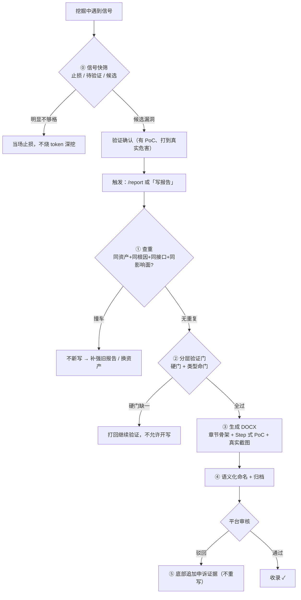

# report — Submission-Ready Vulnerability Reports (Claude Code Skill)

[English](#english) | [中文](#中文)

---

## 工作流程 / Workflow



## 效果预览 / Demo

> 演示对象为虚构靶标 `demo-shop.example`，仅展示生成报告的版式与结构；第 3 张为公共靶场（AltoroJ / demo.testfire.net）实拍，演示真实浏览器渲染页的嵌入效果。
> Demo uses a fictional target to showcase the layout of generated reports; page 3 is a real browser capture from a public practice target, showing how rendered pages are embedded.

| 报告首页（章节骨架） | PoC 步骤页（Step + 请求块 + JSON 截图） | PoC 步骤页（真实浏览器渲染截图） |
|---|---|---|
|  |  |  |

---

## English

A Claude Code skill that turns **confirmed** vulnerabilities into submission-ready **DOCX** reports for SRC (Security Response Center) and 0day platforms.

It doesn't find vulnerabilities — it makes sure the **report** is good enough to survive review.

### What it enforces

- **Two-stage review**: a lightweight signal triage runs **while digging** (stop-loss on dead ends before burning tokens on verification) + full layered verification gates before writing (hard gates: reproducible PoC / impact driven to the final harm / server-side confirmation / falsification tests; per-type criteria for data leak, IDOR, RCE, SSRF, injection; 0day acceptance gates). No gate, no report — this filters out "signal ≠ vulnerability" garbage at the source.
- **Dual readability standard**: a product manager can reproduce it step by step; a security engineer finds it technically solid. Both or rework.
- **Fixed DOCX layout**: `template.docx` ships all styles (Heading 2 sections, uniform black, linear plain document), generated section by section with python-docx.
- **Step-style PoC spec**: every step = one-line title + context + raw HTTP request block copied from any proxy tool (Burp / Yakit / mitmproxy — no curl) + conclusion + real screenshot.
- **Screenshot ironclad rule**: every step needs a real screenshot from the live target; fabricated renders are forbidden. Captures run **fully in the background** (headless / CDP) — no browser or proxy window is ever yanked to the foreground. Packet evidence is embedded as raw text blocks; if the proxy UI is screenshotted, it must be the request/response detail pane, never the history list.
- **Anti-AI-tone rules + machine audit**: kills template phrasing, filler words, and boilerplate — platform reviewers use AI detection plus human intuition, and template-tone reports get downgraded. Enforced by a zero-LLM counter (`tools/ai_taste_check.py`): paren-annotation quota, "attacker"-subject quota, textbook-"该X" quota, nominalized verbs, section-tail summaries, triple parallelism, repeated long IDs, empty severity phrases, EN model-isms. All green before the DOCX is generated.
- **Packet screenshot renderer** (`tools/burp_shot/render.py`): turns real captured bytes (req/resp) into a dark-theme two-pane HTTP debugger screenshot (1588×676, line-number gutters, syntax palette) — byte-faithful, styling wraps bytes without altering them; changing one byte = fabricated evidence.
- **Severity discipline + submission gate**: rating anchors to *the platform's own* system (VRT / outcomes / precedent bands) — CVSS only as fallback; full reasoning lives in a `<report>.gate.md` sidecar (template bundled), never in the report body. `tools/submit_gate.py` reads the sidecar and physically blocks submission until every check passes.
- **Acceptance gate**: before submitting — policy-word mapping + out-of-scope list + precedent + settled-class check + independent red-team review (spawned via the Agent tool as an adversarial triager whose KPI is rejection), answered as verdict + basis + residual risk.
- **Full workflow**: dedup check → gates → humanize rewrite pass + machine audit → DOCX generation → semantic naming → archiving → update-vs-appeal handling → cleanup.

### Install

Copy the directory into Claude Code's skills directory:

```bash
# project-level
cp -r vuln-report-skill <your-project>/.claude/skills/report

# or user-level (global)
cp -r vuln-report-skill ~/.claude/skills/report
```

`SKILL.md` and `template.docx` must stay in the same directory.

Package layout (tools are bundled — nothing extra to fetch):

```
vuln-report-skill/
├── SKILL.md                                  # skill 本体（验证门+版式+流程）
├── README.md / LICENSE
├── template.docx                             # 版式基准（与 SKILL.md 同级，勿分离）
├── templates/submission_scope_gate_template.md   # .gate.md 侧栏模板（定级推导+受理门三查）
├── tools/
│   ├── dedup_check.py                        # 查重（语料 = 你自己的报告库）
│   ├── ai_taste_check.py                     # 去AI味机器审计（零 LLM 计数器）
│   ├── submit_gate.py                        # 交单物理闸（读 .gate.md 侧栏逐项校验，不过闸不出稿）
│   └── burp_shot/                            # 数据包截图渲染（render.py + template.html）
└── docs/                                     # 本 README 效果图
```

### Usage

Once a vulnerability is verified, just say:

```
/report
```

or "写报告 / 出报告 / 成稿 / 生成漏洞报告". The skill triggers automatically and runs gates → layout → workflow end to end.

### Requirements

- `python-docx`: `pip install python-docx`
- **Bundled tools** — `tools/` ships with the skill (dedup / AI-tone audit / submission gate / packet-shot renderer). No extra install; commands in SKILL.md refer to `<skill directory>/tools/...`.
- **`burp_shot` needs a local Chrome or Edge** for headless rendering — auto-detected from common install paths; override with the `BURP_SHOT_CHROME` env var if yours lives elsewhere.
- **Dedup corpus is your own report library** (default `漏洞报告/` under the working directory; point the `DEDUP_CORPUS` env var at your report library). An empty library gets an explicit warning and no verdict — the protection grows as you accumulate reports.
- Screenshots — the AI can only capture screenshots if it has a browser tool. At startup the skill **auto-detects** available browser MCPs (Playwright / chrome-devtools / Puppeteer / etc.) and uses whatever it finds, capturing **in the background without stealing window focus**. If none:
  - **Auto (recommended)**: give Claude Code a browser MCP, e.g. Playwright: `claude mcp add playwright -- npx @playwright/mcp@latest`. The AI then opens original URLs and captures each step itself.
  - **Manual fallback**: if you don't install one, the skill switches to asking you to save each step's screenshot into `shots/` — it embeds them for you. It will never fabricate a render or silently skip a screenshot.
  - `shots/` is temporary: images are embedded into the DOCX, and the folder is deleted when the report is finished.

### Notes

- The skill body (`SKILL.md`) is written in Chinese because the target platforms (Chinese SRCs, CNVD/CNNVD, EDUSRC) require Chinese reports. The methodology — verification gates, per-type criteria, PoC structure, anti-AI-tone rules — is language-agnostic.
- **What it refuses to write**: signals without proven end-to-end harm, your-own-test-account data, below-P3 findings, CORS/security-header non-issues. The gate blocks them and tells you why.

---

## 中文

一个 Claude Code skill：把**已确认**的漏洞写成可直接提交 SRC / 0day 平台审核方的 **DOCX** 提交稿。

它不教你怎么挖漏洞，只解决一件事：**报告写得够不够好**。

### 它约束什么

- **双重审查机制**：第一道在**挖掘过程中**跑——遇到信号先快筛（明显不够格的当场止损，不浪费 token 深挖）；第二道在成稿前跑——完整分层验证门（硬门 / 按类型命门表 / 0day 收录审查门）。不过门不成稿，从源头挡掉"信号当漏洞"的垃圾报告。
- **双重可读写作标准**：产品经理照着 Step 能复现，安全工程师看完觉得技术扎实——两个维度缺一返工。
- **固定 DOCX 版式**：`template.docx` 内置全部样式（微软雅黑、Heading 2 章节、全文统一黑色），python-docx 逐节生成，朴素线性文档，不堆表格卡片。
- **Step 式 PoC 规格**：每步 = 一句话标题 + 操作上下文 + 原始请求块（从 Burp/Yakit 等任意抓包工具原文复制，不放 curl）+ 结果结论 + 真实截图。
- **截图铁律**：每步必须配真实目标截图，严禁自造渲染。截图**全程后台完成**（headless/CDP），不把浏览器或抓包工具窗口弹到前台；数据包以原始文本块入报告，截工具界面时只截请求/响应详情面板，不截历史列表。
- **简洁硬规 + 去 AI 腔硬规 + 机器审计**：消灭八股标签、填充语、形容词渲染、模板化句式——平台 AI 检测和人工直觉都会筛掉模板腔报告。配套零 LLM 计数器 `tools/ai_taste_check.py`（括号注解/主语复读/教科书腔/名词化动词/节尾总结/三连排比/ID 复现/空话/英文 model-isms 逐项计数），全绿才进 DOCX 生成。
- **数据包截图渲染**（`tools/burp_shot/render.py`）：真实抓包字节 → 暗色双栏 HTTP 调试工具截图（1588×676，行号/语法着色），字节级忠实，渲染只做外壳。
- **定级纪律 + 交单物理闸**：定级锚目标平台自己的体系（VRT / outcomes / 判例带），CVSS 只兜底；完整推导写 `<报告名>.gate.md` 侧栏（模板随包），禁入报告正文；`tools/submit_gate.py` 读侧栏逐项校验，不过闸不进提交流程。
- **完整成稿流程**：查重 → 过验证门 → 人化改写 pass + 机器审计 → 生成 DOCX → 语义化命名 → 归档 → 更新/驳回两种处理 → 收尾清理。

### 安装

把整个目录复制到 Claude Code 的 skills 目录：

```bash
# 项目级
cp -r vuln-report-skill <your-project>/.claude/skills/report

# 或用户级（全局可用）
cp -r vuln-report-skill ~/.claude/skills/report
```

目录内需保持 `SKILL.md` 与 `template.docx` 同级。工具随包分发，SKILL.md 里的命令以 `<skill目录>/tools/...` 引用，无需另装。

### 使用

漏洞验证到位后直接说：

```
/report
```

或"写报告 / 出报告 / 成稿 / 生成漏洞报告"，skill 会自动触发，按验证门 → 版式 → 流程走完全程。

### 依赖

- `python-docx`（生成 DOCX）：`pip install python-docx`
- **工具随包自带**：`tools/` 目录（查重 / 去AI味审计 / 交单物理闸 / 数据包截图渲染）随 skill 分发，无需另装
- **burp_shot 需要本机有 Chrome 或 Edge** 做 headless 截图渲染——自动检测常见安装路径，找不到时设环境变量 `BURP_SHOT_CHROME` 指向浏览器可执行文件
- **查重语料 = 你自己的历史报告库**（默认当前目录 `漏洞报告/`，环境变量 `DEDUP_CORPUS` 可指向你的报告库）。空库会明确告警且不给出判定——保护力随你的报告库积累而增长
- 截图——AI 手里有浏览器工具才能自动截图。skill 开工时会**自动检测**当前环境里可用的浏览器类 MCP（Playwright / chrome-devtools / Puppeteer 等），检测到什么就用什么，**全程后台截图不抢窗口焦点**。都没有则：
  - **自动（推荐）**：给 Claude Code 装一个浏览器 MCP，例如 Playwright：`claude mcp add playwright -- npx @playwright/mcp@latest`，AI 就能自己打开原始 URL 逐步截图。
  - **手动降级**：不装工具时，skill 会改成"你把每步截图存进 `shots/` 目录，我来嵌入"。绝不会自造渲染图，也不会静默跳过截图。
  - `shots/` 是临时目录：图片已内嵌 DOCX，报告成稿后该目录自动清除。

### 快速上手（完整流程示例）

前提：你已经**验证确认**了一个漏洞（有可用 PoC、打到真实危害）。这个 skill 不负责挖漏洞，只负责成稿。

```
你:   我刚确认了 api.example.com 的订单接口越权，B 的 token 能读 A 的订单，
      手机号/地址/身份证都拿到了，Burp 抓包和截图都在。写报告。

Claude:（自动触发本 skill）
  1. 查重 —— 翻你历史报告目录，确认没写过同根因的
  2. 过验证门 —— 逐条核对硬门/类型命门，不够格会直接告诉你缺什么
  3. 生成 DOCX —— 按固定版式：章节骨架 + Step 式 PoC + 内嵌截图
  4. 语义化命名 ——「api.example.com 存在订单接口越权读取他人敏感信息漏洞.docx」
  5. 归档到 reports/<单位>src/；shots/ 截图目录成稿后自动清除（图片已内嵌 DOCX）
```

产物只有一份 DOCX，可以直接交平台。被驳回后说"报告被驳回了，补充申诉证据"，会走底部追加模式而不是重写。

**它会拒绝写什么**：只有信号没到终局危害的、自己测试账号的数据、P3 以下、CORS/安全头类——验证门会直接拦下并说明原因，不会硬凑一份垃圾报告。

### 适用场景

- 企业 SRC 漏洞提交稿（各厂商 SRC 通用版式）
- EDUSRC 教育行业漏洞报告
- 0day / 通用产品漏洞报告（内置通用型模板章节骨架 + 收录审查门）

## License

MIT — 详见 [LICENSE](LICENSE)。
